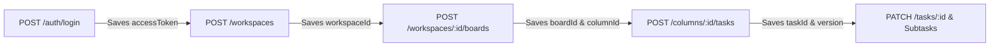

# Enterprise Task Manager API - Postman Collection & Testing Guide

This directory contains the production-grade **Postman Collection (v2.1.0)** and **Environment configuration** to test 100% of the Enterprise Task Manager API endpoints in a structured, organized, and automated manner.

---

## 📁 Included Files

| File | Description |
|---|---|
| [`enterprise-task-manager.postman_collection.json`](file:///c:/Users/Dell/Projects/Enterprise%20Task%20Manager%20API/postman/enterprise-task-manager.postman_collection.json) | Full Postman collection with **11 organized folders**, 51 requests, automated environment variable extraction, and test assertions. |
| [`enterprise-task-manager.postman_environment.json`](file:///c:/Users/Dell/Projects/Enterprise%20Task%20Manager%20API/postman/enterprise-task-manager.postman_environment.json) | Local / Dev environment pre-populated with default base URL (`http://localhost:3000`), demo credentials, and dynamic placeholder variables. |

---

## 🚀 Quick Start (Importing into Postman)

1. **Open Postman** (Desktop app or Web).
2. Click the **Import** button in the top-left corner.
3. Drag & drop or select both files:
   - `postman/enterprise-task-manager.postman_collection.json`
   - `postman/enterprise-task-manager.postman_environment.json`
4. In the top-right environment dropdown, select: **`Enterprise Task Manager - Local / Dev`**.
5. Ensure your local server is running:
   ```bash
   npm run dev
   ```

---

## 🔄 Automated Variable Chaining (Zero Copy-Pasting)

Every request in the collection is wired with **Postman Test Scripts** that automatically capture IDs, tokens, and versions into your active environment:



- **Authentication:** `POST /auth/login` extracts `response.data.accessToken` and stores it in `{{accessToken}}`. All subsequent requests automatically inherit Bearer authentication.
- **Workspaces:** `POST /workspaces` extracts `response.data.id` and stores it in `{{workspaceId}}`.
- **Boards & Columns:** `POST /workspaces/:id/boards` stores `{{boardId}}` and the first starter column ID in `{{columnId}}`.
- **Tasks & Optimistic Concurrency:** `POST /columns/:id/tasks` stores `{{taskId}}` and `{{taskVersion}}`. Subsequent `PATCH /tasks/:id` calls automatically provide the current version number.
- **Idempotency Keys:** Task and Comment creation requests automatically inject dynamic `Idempotency-Key: task-create-{{$guid}}` headers.
- **S3 Pre-signed Flow:** `POST /tasks/:id/attachments/presign` extracts `{{attachmentKey}}` and `{{uploadUrl}}`, which are piped directly into the confirmation request.

---

## 📂 Collection Structure (11 Organized Folders)

### 01. System & Health
Endpoints for container orchestrators (Kubernetes/ECS), load balancers, and observability:
- `GET {{baseUrl}}/health` — Liveness probe (200 OK with server timestamp).
- `GET {{baseUrl}}/ready` — Readiness probe (validates live PostgreSQL `SELECT 1` and Redis `PING`).
- `GET {{baseUrl}}/metrics` — Prometheus text format metrics (HTTP RED metrics, latency histograms, event loop lag).
- `GET {{baseUrl}}/openapi.json` — Raw OpenAPI 3.1 specification generated from Zod schemas.

### 02. Authentication
Full authentication lifecycle with argon2id password hashing and rotating refresh tokens:
- `POST {{baseUrl}}/auth/signup` — Register new user account.
- `POST {{baseUrl}}/auth/verify-email` — Verify email via SHA-256 token.
- `POST {{baseUrl}}/auth/login` — Authenticate and auto-set `{{accessToken}}`.
- `POST {{baseUrl}}/auth/refresh` — Rotate refresh token family via HttpOnly cookie.
- `POST {{baseUrl}}/auth/forgot-password` — Request password reset email (anti-enumeration).
- `POST {{baseUrl}}/auth/reset-password` — Set new password and invalidate prior sessions.
- `POST {{baseUrl}}/auth/logout` — Revoke token family and clear auth cookies.

### 03. Workspaces
Multi-tenant isolation and administrative workspace settings:
- `POST {{baseUrl}}/workspaces` — Create workspace (caller becomes `OWNER`).
- `GET {{baseUrl}}/workspaces` — List workspaces for the authenticated user.
- `GET {{baseUrl}}/workspaces/{{workspaceId}}` — Retrieve workspace details and role.
- `PATCH {{baseUrl}}/workspaces/{{workspaceId}}` — Rename workspace (`OWNER` only).
- `DELETE {{baseUrl}}/workspaces/{{workspaceId}}` — Delete workspace and cascade all child records (`OWNER` only).

### 04. Members & Invitations
Role-Based Access Control (`OWNER`, `ADMIN`, `MEMBER`, `VIEWER`):
- `GET {{baseUrl}}/workspaces/{{workspaceId}}/members` — List all members and roles.
- `POST {{baseUrl}}/workspaces/{{workspaceId}}/invitations` — Invite colleague via email token (`ADMIN`+).
- `POST {{baseUrl}}/invitations/accept` — Accept invitation token.
- `PATCH {{baseUrl}}/workspaces/{{workspaceId}}/members/{{memberUserId}}` — Update role (`ADMIN`+).
- `DELETE {{baseUrl}}/workspaces/{{workspaceId}}/members/{{memberUserId}}` — Remove member or leave workspace.

### 05. Tags
Workspace-scoped categorization labels:
- `POST {{baseUrl}}/workspaces/{{workspaceId}}/tags` — Create tag with hex color.
- `GET {{baseUrl}}/workspaces/{{workspaceId}}/tags` — List all tags in workspace.

### 06. Boards & Columns
Kanban board management with Redis cache-aside reads:
- `POST {{baseUrl}}/workspaces/{{workspaceId}}/boards` — Create board with starter columns (Backlog, In Progress, Done).
- `GET {{baseUrl}}/workspaces/{{workspaceId}}/boards` — List boards in workspace.
- `GET {{baseUrl}}/boards/{{boardId}}` — Get board columns and task counts (**Cached in Redis**).
- `PATCH {{baseUrl}}/boards/{{boardId}}` — Update board title (invalidates Redis cache).
- `POST {{baseUrl}}/boards/{{boardId}}/columns` — Add new column with fractional position.
- `PATCH {{baseUrl}}/columns/{{columnId}}` — Rename or reorder column.
- `DELETE {{baseUrl}}/columns/{{columnId}}` — Delete column and nested tasks.
- `DELETE {{baseUrl}}/boards/{{boardId}}` — Delete board.

### 07. Tasks
Core task engine with fractional positioning and optimistic locking:
- `POST {{baseUrl}}/columns/{{columnId}}/tasks` — Create task with `Idempotency-Key` (writes task, ActivityLog, and OutboxEvent atomically).
- `GET {{baseUrl}}/tasks/{{taskId}}` — Get task with subtasks, assignees, tags, and comments.
- `GET {{baseUrl}}/boards/{{boardId}}/tasks` — Keyset cursor search with filters (`status`, `priority`, `limit=20`) optimized with parallel index scans.
- `PATCH {{baseUrl}}/tasks/{{taskId}}` — Update task fields with optimistic concurrency version check (`version: {{taskVersion}}`).
- `PATCH {{baseUrl}}/tasks/{{taskId}}/move` — Move task across columns or reorder using midpoint fractional positioning.
- `PUT {{baseUrl}}/tasks/{{taskId}}/assignees` — Assign workspace members.
- `PUT {{baseUrl}}/tasks/{{taskId}}/tags` — Attach tags.
- `DELETE {{baseUrl}}/tasks/{{taskId}}` — Soft-delete task (`deletedAt` timestamp).

### 08. Subtasks
Checklist items nested under parent tasks:
- `POST {{baseUrl}}/tasks/{{taskId}}/subtasks` — Create subtask.
- `PATCH {{baseUrl}}/tasks/{{taskId}}/subtasks/{{subtaskId}}` — Toggle `done: true` or rename.
- `DELETE {{baseUrl}}/tasks/{{taskId}}/subtasks/{{subtaskId}}` — Remove subtask.

### 09. Comments
Discussion thread on tasks:
- `POST {{baseUrl}}/tasks/{{taskId}}/comments` — Post comment (idempotent).
- `GET {{baseUrl}}/tasks/{{taskId}}/comments` — List comments with author details.

### 10. Activity Log & Audit Trail
Enterprise monthly-partitioned audit trails:
- `GET {{baseUrl}}/tasks/{{taskId}}/activity` — Retrieve immutable audit trail for a task.
- `GET {{baseUrl}}/boards/{{boardId}}/activity` — Retrieve real-time board-wide activity feed.

### 11. Attachments (S3 / R2 Flow)
Direct-to-cloud file uploads without buffering bytes on the Node.js server:
- `POST {{baseUrl}}/tasks/{{taskId}}/attachments/presign` — Request pre-signed S3 PUT URL and storage key.
- `POST {{baseUrl}}/tasks/{{taskId}}/attachments/confirm` — Register upload completion in database.
- `GET {{baseUrl}}/tasks/{{taskId}}/attachments` — List metadata of task attachments.
- `GET {{baseUrl}}/attachments/{{attachmentId}}/url` — Generate secure, time-limited GET download URL.
- `DELETE {{baseUrl}}/attachments/{{attachmentId}}` — Delete file from S3 and database.

---

## ⚡ Running Headlessly via Newman (CLI)

You can run the entire collection headlessly from your terminal using [Newman](https://www.npmjs.com/package/newman):

```bash
# Run with npx (no global install required)
npx newman run postman/enterprise-task-manager.postman_collection.json -e postman/enterprise-task-manager.postman_environment.json
```

Or run via the configured package script:
```bash
npm run test:newman
```
